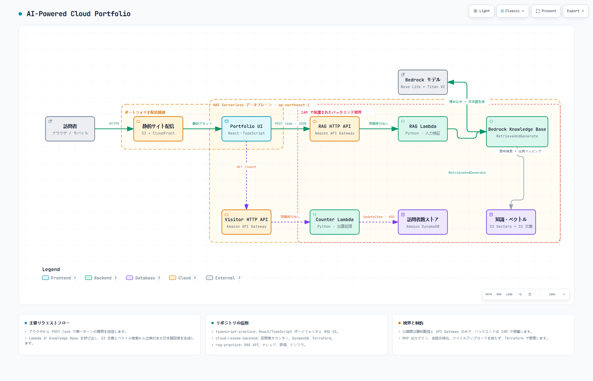

# AI-Powered Cloud Portfolio — Frontend

[日本語](./README.md) | English

A Japanese cloud resume built with React, TypeScript, Tailwind CSS, and Vite and hosted on GitHub Pages. Its Cloud Resume Challenge case study documents the earlier AWS deployment.

[Live resume](https://luolifan-chuo.github.io/typescript-practice/)

## System architecture

[](docs/architecture/AI-Powered-Cloud-Portfolio.html)

The interactive diagram shows the original AWS deployment. This repository contains the `Portfolio UI` shown in the diagram.

## Frontend responsibilities

- Component-based resume UI built with React 18 and TypeScript
- Vite development server and production build
- Responsive layouts with Tailwind CSS
- Optional Japanese RAG chat UI and IT Trends feed
- Answer, citation, loading, timeout, and API error states
- Automated checks with ESLint, TypeScript, and Vitest

## Project structure

```text
src/App.tsx                     Overall page composition
src/components/RagChatbot.tsx  Resume RAG chat UI
src/services/ragApi.ts          Type-safe POST /ask client
src/components/sections/        Profile, Skills, Projects, and other sections
src/data/                       Portfolio content
```

## Local development

```powershell
npm install
npm run dev
```

Set `VITE_RAG_API_URL` or `VITE_TRENDS_DATA_URL` in `.env.local` to connect the corresponding feature. For deployed builds, set the GitHub Actions repository variables with the same names. The default build hides the chat and links from IT Trends to its case study.

## Deploy to GitHub Pages

Choose **GitHub Actions** in the repository's **Settings → Pages**. A push to `main` or a manual workflow run tests the app, builds it, and publishes `dist`.

## Quality checks

```powershell
npm run typecheck
npm run lint
npm test
npm run build
```

## Technology

- React 18
- TypeScript 5
- Vite 5
- Tailwind CSS
- Vitest / Testing Library
- GitHub Pages / GitHub Actions

## Security principles

- Do not place AWS credentials, Knowledge Base IDs, model ARNs, or system prompts in browser code
- Validate API responses at runtime before rendering them
- Keep the RAG interaction single-turn and do not persist questions or answers in the frontend
- Display only public source titles and sections

## Related repositories

- [rag-practice](https://github.com/LUOLIFAN-CHUO/rag-practice) — RAG API, knowledge content, and Amazon Bedrock infrastructure
- [cloud-resume-backend](https://github.com/LUOLIFAN-CHUO/cloud-resume-backend) — visitor-counter API from the original AWS deployment

## Architecture artifacts

- [Interactive HTML](docs/architecture/AI-Powered-Cloud-Portfolio.html)
- [Archify source specification](docs/architecture/AI-Powered-Cloud-Portfolio.architecture.json)
- [PNG preview](docs/architecture/AI-Powered-Cloud-Portfolio.png)
