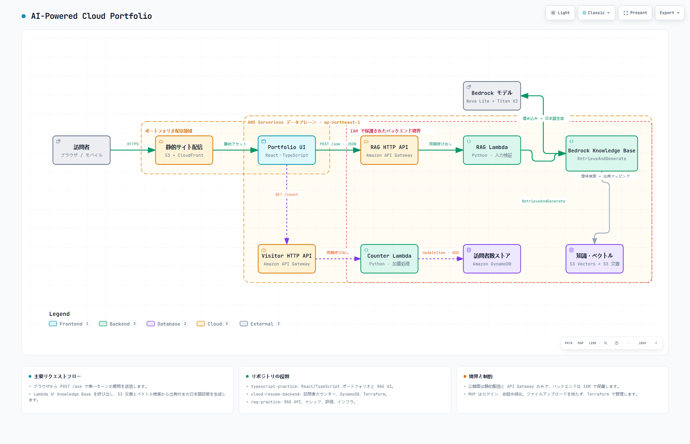

# AI-Powered Cloud Portfolio — Frontend

日本語 | [English](./README.en.md)

React、TypeScript、Tailwind CSS、Vite で構築した日本語のクラウド履歴書です。GitHub Pages で静的に公開し、AWS で構築したアーキテクチャをプロジェクトとして紹介しています。

[公開サイト](https://luolifan-chuo.github.io/typescript-practice/)

## プロジェクトのリポジトリ

このリポジトリは Cloud Portfolio のメイン入口です。AWS 上の HTML 履歴書から、GitHub Pages で公開する React 履歴書へ移行しました。

| Repository | Role / status |
| --- | --- |
| [typescript-practice](https://github.com/LUOLIFAN-CHUO/typescript-practice) | 現在の React 履歴書と GitHub Pages 公開 |
| [cloud-resume-frontend](https://github.com/LUOLIFAN-CHUO/cloud-resume-frontend) | 旧 HTML フロントエンド・アーカイブ |
| [cloud-resume-backend](https://github.com/LUOLIFAN-CHUO/cloud-resume-backend) | 旧訪問者カウンター・アーカイブ |
| [rag-practice](https://github.com/LUOLIFAN-CHUO/rag-practice) | 独立した Bedrock RAG コンポーネント・デモ休止中 |

## システム全体像

[](docs/architecture/AI-Powered-Cloud-Portfolio.html)

図は AWS 運用時の構成を示しています。このリポジトリは図の `Portfolio UI` を担当します。

## フロントエンドの役割

- React 18 と TypeScript によるコンポーネントベースの履歴書 UI
- Vite による開発サーバーと production build
- Tailwind CSS によるレスポンシブな画面設計
- 接続先を設定したときに利用できる日本語 RAG チャットと IT Trends フィード
- 回答、出典、読み込み、タイムアウト、API エラーの表示
- Hacker News・Zenn・Qiita の記事を Gemini で日中英に要約する IT Trends ページ
- ESLint、TypeScript、Vitest による自動検証
- GitHub Actions で検証し、GitHub Pages に公開

## 主な構成

```text
src/App.tsx                     ページ全体の構成
src/components/RagChatbot.tsx  履歴書 RAG チャット UI
src/services/ragApi.ts          POST /ask の型安全な API クライアント
src/components/sections/        Profile、Skills、Projects などの各セクション
src/data/                       表示コンテンツ
```

## ローカル開発

```powershell
npm install
npm run dev
```

RAG API の URL は `VITE_RAG_API_URL`、トレンドデータの URL は `VITE_TRENDS_DATA_URL` で設定できます。ローカルでは `.env.local`、公開ビルドでは GitHub Actions のリポジトリ変数を使用します。未設定時は AI チャットを非表示にし、IT Trends はプロジェクト紹介へ案内します。

## GitHub Pages への公開

リポジトリの **Settings → Pages** で **GitHub Actions** を選択します。`main` への push または Actions タブからの手動実行で、テストとビルドを経て `dist` を公開します。

## IT Trends

フィードを設定すると、履歴書の「ITトレンド」から記事を表示できます。記事は情報源・カテゴリーで絞り込みでき、要約表示を日本語・中国語・英語に切り替えられます。

## 品質チェック

```powershell
npm run typecheck
npm run lint
npm test
npm run build
```

## 技術スタック

- React 18
- TypeScript 5
- Vite 5
- Tailwind CSS
- Vitest / Testing Library
- GitHub Pages / GitHub Actions

## セキュリティ方針

- AWS 認証情報、Knowledge Base ID、モデル ARN、システムプロンプトをブラウザへ配置しない
- API レスポンスを実行時に検証し、不正なレスポンスを UI に展開しない
- RAG は単一ターンで、質問や回答をフロントエンドに永続化しない
- 公開用のタイトルとセクションだけを出典として表示する

## 関連リポジトリ

- [rag-practice](https://github.com/LUOLIFAN-CHUO/rag-practice) — RAG API、ナレッジ、Amazon Bedrock インフラ
- [cloud-resume-backend](https://github.com/LUOLIFAN-CHUO/cloud-resume-backend) — AWS 運用時の訪問者カウンター API

## アーキテクチャ成果物

- [インタラクティブ HTML](docs/architecture/AI-Powered-Cloud-Portfolio.html)
- [Archify ソース仕様](docs/architecture/AI-Powered-Cloud-Portfolio.architecture.json)
- [PNG プレビュー](docs/architecture/AI-Powered-Cloud-Portfolio.png)
